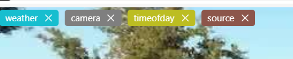
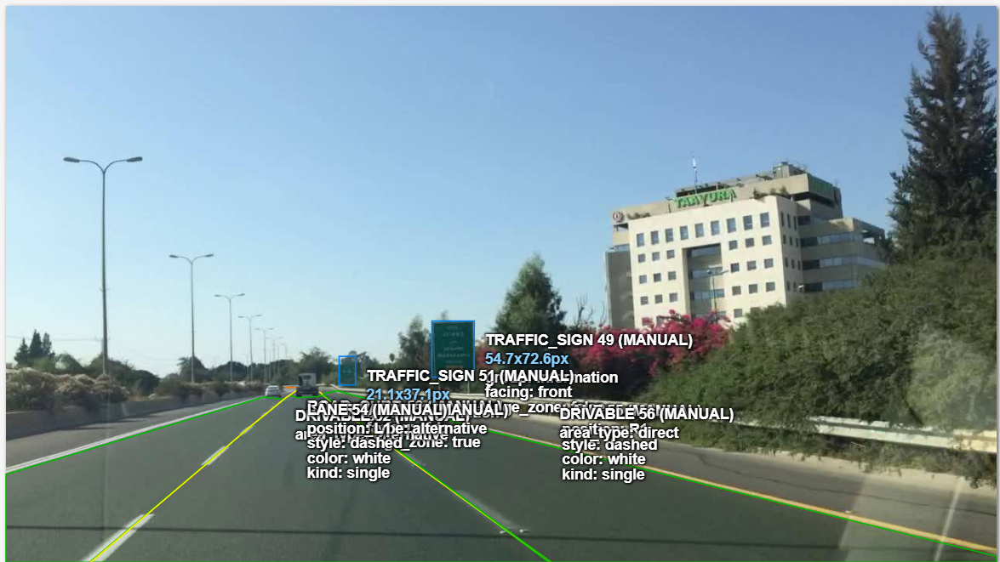
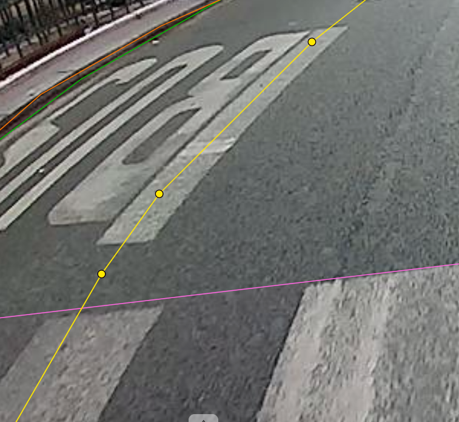
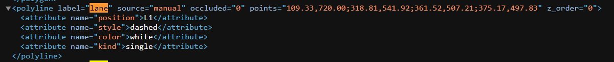

# Báo cáo cá nhân — Ngày 11
Họ tên: Đặng Quốc Thái              Mã học viên: 2A202603166  
Phiên bản CVAT (Help → About):  2.74.1
Guideline: Road v1.0    Lần nộp (`revision` trong manifest):  
Thời điểm export (ngày giờ trên CVAT): 21/11/2026    Số lần nộp lại sau Rework: 1

## 1. Kiểm project
| Mục | Đúng như guideline Road v1.0? | Ghi chú |
| --- | --- | --- |
| 6 label, đúng kiểu | Đúng theo guideline  |  |
| Thuộc tính và giá trị | Đúng theo guideline |  |
| 4 tag ảnh | Đúng theo guideline |  |
Cách kết thúc polyline trên bản CVAT này:  Sau khi kết thúc line, nhấp N để thoát polyline tại điểm cuối cùng đã annotate
Cách đặt tag ảnh trên bản CVAT này:  Nhấp vào Tag, nhấp nút cộng cho mỗi dropdown item của nó và chọn attribute phù hợp của tag

## 2. Số lượng đã gán
| Task | Ảnh | lane | road_curb | crosswalk | drivable | traffic_light | traffic_sign |
| --- | ---: | ---: | ---: | ---: | ---: | ---: | ---: |
| front | 12 | 25 | 19 | 5 | 21 | 48 | 61 |
| front-extra (đã làm __ / 4) |  |  |  |  |  |  |  |
| fisheye | 8 | 6 | 19 | 11 | 6 | 9 | 14 |
| fisheye-extra (đã làm __ / 4) |  |  |  |  |  |  |  |

Số lượng shape đếm từ hai file CVAT for images 1.1 XML; không tính tag ảnh.

## 3. Bảng ca khó
| Ảnh | Nhãn | Phân vân giữa | Đã chọn | Lý do |
| --- | --- | --- | --- | --- |

## 4. Phiếu QC 1 nhận được
Bạn kiểm lô của tôi:  Quyết định nhận được:  
| Mã lỗi | Số lỗi | Đồng ý? | Đã sửa? |
| --- | --- | --- | --- |
| QC1-01 | 1 | Đồng ý | Đã sửa |
| QC1-07 | 1 | Đồng ý | Chưa sửa |
| QC1-11 | 1 | Đồng ý | Chưa sửa |
| QC1-12 | 1 | Đồng ý | Chưa sửa |

## 5. Kiểm file export
| File | Mở lại được? | Số shape ảnh 1 (job / file) | Số shape ảnh 2 (job / file) | Tag camera có trong XML? |
| --- | --- | --- | --- | --- |
| dangquocthai-front.zip | Mở lại được | 8 | 5 | Không |
| dangquocthai-fisheye.zip | Mở lại được | 5 | 14 | Không |

## 6. Ảnh chụp màn hình
1. Tab Labels của project. 

2. Một ảnh camera trước đã gán đủ (làn, vùng lái, đèn/biển).

3. Một ảnh fisheye đã gán, phóng to đoạn polyline cong.

4. Một đoạn XML có <polyline label="lane">. 

## 7. Tự đánh giá
Lỗi bạn mắc nhiều nhất hôm nay (theo mã QC1-xx), và cách tránh ở Ngày 20:  
- Lỗi mắc nhiều nhất hôm nay là lỗi đánh edge case, và để tránh lỗi này cần phải kiểm tra mép của object đi theo ngưỡng bán kính mà guideline yêu cầu
Nhãn của bạn đi vào model ở đâu? Chọn một lỗi đã sửa và nói nó làm model học sai thế nào:  
- Nhãn đi vào model dưới dạng Ground Truth trong dữ liệu train. Ảnh là đầu vào, còn các vùng và thuộc tính đã gán là đáp án để model học. Mình đã sửa lỗi đặt nhầm tag Fisheye Front thành Front, điều này sẽ ảnh hưởng nghiêm trọng cho việc mô hình nhận dạng kiểu camera, dẫn đến việc phát hiện vật thể sai
## 8. (Tùy chọn, buffer) Từ polyline đến đích row-anchor
| y | 720 | 680 | 640 | 600 | 560 |
| --- | ---: | ---: | ---: | ---: | ---: |
| x của chúng tôi |  |  |  |  |  |
| x của bạn kia |  |  |  |  |  |

Trả lời 3 câu:

1. Năm số x đó chính là đích mà một model row-anchor học cho vạch này. Nếu bạn dừng polyline sớm 40 px, hàng nào đổi thành "không có làn"?
2. So với bạn được kiểm (cùng ảnh): ở hàng 720 và hàng 560, hai bạn lệch nhau bao nhiêu pixel? Lệch ở hàng nào ảnh hưởng LKA nhiều hơn (slide 25)?
3. Nếu polyline vẽ từ xa về gần (ngược quy tắc 2), cách tính trên có đổi không? Script nào sẽ gặp khó?
